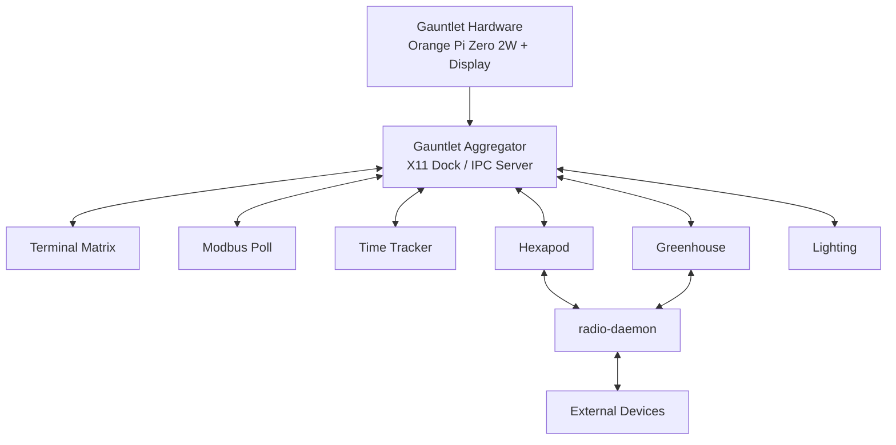

<table align="right">
  <tr>
    <td><b>🇬🇧 English</b></td>
    <td><a href="./README_RU.md">🇷🇺 Русский</a></td>
  </tr>
</table>

# 🦾 Gauntlet — Wearable Linux Engineering Terminal

**Gauntlet** is a wearable Linux-based engineering terminal designed to keep development tools, device controls and basic measurement functions directly on the forearm.

The project combines:

- an ARM64 Linux computer;
- a 5.5" QHD display;
- a modular Qt 6 software environment;
- physical interfaces for external electronics;
- planned R/C/component/servo testers;
- a motorized display carriage inspired by Bakugan New Vestroia.

The concept is closer to a **wearable embedded laboratory** than to a smartwatch or phone interface.

---

## 🎯 Project Goal

Gauntlet is intended to provide quick access to engineering tools without requiring a laptop or separate bench instrument for every simple operation.

Typical use cases include:

- opening several engineering terminals;
- polling and writing Modbus registers;
- controlling the Hexapod;
- monitoring the Greenhouse;
- controlling room lighting;
- connecting to external electronics through physical interfaces;
- measuring simple components directly from the device.

The software stack is intentionally modular so new tools can be added without redesigning the hardware platform.

---

## ⚙️ Current Hardware Specification

| Component | Current design |
|---|---|
| Form factor | Forearm-mounted Linux terminal |
| External dimensions | **211 × 88 × 40 mm** |
| Computer | **Orange Pi Zero 2W, 4 GB** |
| OS / UI | Linux + Qt 6 |
| Display | **Sharp LS055R1SX04**, 5.5", QHD 1440 × 2560 |
| Video | Mini HDMI → HDMI-FPC → display controller |
| Battery | **4 × EVE INR18650-25P**, 2S2P |
| Energy | ~7.2 V / 5 Ah / **36 Wh** |
| Mechanical body | 3D-printed PETG |
| Design | White / purple |
| CAD | FreeCAD |

The current repository contains the software stack and the FreeCAD source model. The mechanical and electrical assembly is still under development.

---

## 🏗 System Architecture



Each tool is an independent process.

The Aggregator does not embed the applications into one monolithic program. Instead, applications register through local IPC and receive `show` / `hide` commands.

---

# 🖥 Software Environment

## Gauntlet Aggregator

`GauntletAggregator` is the central desktop shell.

It creates a **64 px bottom dock** using Qt and X11.

The panel contains launch/select buttons for:

- Greenhouse;
- lighting;
- Hexapod;
- Modbus Poll;
- Terminal Matrix;
- Time Tracker.

X11/EWMH properties are used to make the window behave like a real desktop dock:

```text
_NET_WM_WINDOW_TYPE_DOCK
_NET_WM_STRUT
_NET_WM_STRUT_PARTIAL
```

The dock can also collapse so that only its show/hide button remains visible.

---

## Local IPC

Applications connect to the Aggregator through:

```text
QLocalSocket → "aggregator"
```

and register themselves using newline-delimited JSON.

Example:

```json
{
  "type": "register",
  "app": "terminal_matrix"
}
```

Visibility is controlled through commands such as:

```json
{
  "type": "show",
  "app": "terminal_matrix"
}
```

and:

```json
{
  "type": "hide",
  "app": "*"
}
```

This keeps individual tools independent while presenting them as one integrated environment.

---

# 🖥 Terminal Matrix

The current implementation provides a **4 × 3 matrix of embedded terminals** using QTermWidget.

```text
┌────┬────┬────┬────┐
│ T1 │ T2 │ T3 │ T4 │
├────┼────┼────┼────┤
│ T5 │ T6 │ T7 │ T8 │
├────┼────┼────┼────┤
│ T9 │T10 │T11 │T12 │
└────┴────┴────┴────┘
```

Each terminal runs `/bin/bash` and has its own:

- working directory;
- label;
- frame color.

Terminal layouts can be saved to and loaded from JSON.

Keyboard controls include:

- `Shift + Tab` — next terminal;
- `Ctrl + Shift + C` — copy;
- `Ctrl + Shift + V` — paste.

The long-term software design allows the same application to use different matrix dimensions through configuration rather than maintaining separate PC and Gauntlet implementations.

---

## Terminal Hotkey

`TerminalHotkey` connects a system hotkey to Terminal Matrix.

It sends:

```json
{
  "type": "toggle_terminal"
}
```

to the Aggregator.

If the Gauntlet environment is unavailable, it falls back to:

```text
x-terminal-emulator
```

---

# 🔧 Modbus Poll

Gauntlet includes a custom **Modbus RTU diagnostic tool** based on Qt SerialBus.

Configurable parameters include:

- serial port;
- baud rate;
- parity;
- data bits;
- stop bits;
- slave address;
- register start address;
- register count;
- polling period.

Supported register interpretations:

```text
UInt16
Int16
UInt32 ABCD
Float32 ABCD
```

The application provides:

- automatic polling;
- register names;
- read/error counters;
- Holding Register writes;
- JSON configuration profiles.

This makes it useful as a reusable field/debugging tool rather than a device-specific GUI.

---

# ⏱ Time Tracker

`TimeTracker` records the amount of time spent in active windows.

On Linux it obtains the focused X11 window through:

```text
_NET_ACTIVE_WINDOW
_NET_WM_NAME
```

Statistics are divided into:

- a current 5-minute period;
- total time for the current application session.

A Windows implementation is also present in the source.

---

# 🕷 Hexapod Control

The integrated Hexapod panel provides:

```text
W / A / S / D → movement
B             → base mode
```

Multiple WASD inputs are represented as a bit mask.

Movement uses **latest-state semantics** instead of an ordinary command FIFO.

If newer motion input arrives while an older command is still queued, the obsolete pending command is replaced.

This avoids delayed execution of stale movement commands.

---

## Live 3D Model

The interface contains a Qt Quick 3D model of the Hexapod.

Incoming telemetry provides:

```text
6 legs × 3 joint angles = 18 values
```

for:

- coxa;
- femur;
- tibia.

The model updates individual joint angles from the received state.

---

# 🌱 Greenhouse Integration

The Greenhouse panel provides:

- air temperature;
- air humidity;
- soil moisture;
- live charts;
- manual watering;
- fan control;
- automatic watering;
- automatic ventilation;
- configurable soil threshold.

The application communicates with the remote controller through the common `radio-daemon`.

---

# 📡 Shared Radio Architecture

Applications that use the radio network do not access the physical serial port directly.

```text
Qt Application
      ↓
QLocalSocket / JSON
      ↓
radio-daemon
      ↓
Serial / Radio
      ↓
Remote Device
```

This allows the physical link to be shared between multiple tools while keeping queueing and transport logic outside the GUI.

---

# 🧱 Mechanical System

The mechanical concept includes a motorized transparent carriage above the display.

The carriage uses:

- two side racks;
- two drive positions;
- module 0.8 gearing;
- a transparent central window;
- a permanent activation card.

The carriage moves along the display surface and exposes the interaction area below it.

Synchronization, travel limits and jam detection remain part of the mechanical development work.

---

## Activation Card

The design uses one permanent transparent activation card rather than interchangeable cards.

The card acts as a spatial color filter above the QHD display.

The intended visual system combines:

```text
dynamic LCD image
      +
printed transparent color filter
      =
final appearance
```

A future calibration layer may compensate for spatial RGB transmission differences in the printed card.

---

# 🔋 Power System

The current battery design uses:

```text
4 × EVE INR18650-25P
        ↓
       2S2P
        ↓
~7.2 V / 5 Ah / 36 Wh
```

A 2S BMS is part of the design.

The BMS provides battery protection but does not replace the required 8.4 V CC/CV charging system.

---

# 🔌 Planned Engineering Interfaces

The front section is intended to provide physical access to external electronics.

Interfaces under consideration include:

- CAN;
- RS-485 / Modbus;
- UART;
- SWD;
- optionally I²C / SPI;
- measurement inputs;
- external power.

The connector layout is not finalized.

---

# 🧪 MK1 Measurement Hardware

A completed MK1 is intended to include three basic hardware testers.

## Resistance

Planned concept:

```text
known selectable Rref
        +
unknown Rx
        ↓
12-bit STM32 ADC
        ↓
automatic range selection
```

## Capacitance

Capacitance measurement is planned through controlled RC charge/discharge timing.

Protection against connecting an already charged capacitor is required.

## Servo Tester

Planned features:

- GND / power / signal output;
- STM32 PWM generation;
- neutral position;
- configurable range;
- sweep control from Qt;
- current-limited external servo supply.

These measurement functions are planned for a separate STM32 board.

---

# 🔬 Later Measurement Extensions

Not required for the first completed MK1:

- DMM functionality;
- oscilloscope;
- electronic load;
- more advanced measurement front-ends.

These require their own analog protection and signal-conditioning hardware and are treated as later expansions rather than software-only features.

---

# 🚧 Software Roadmap

The technical specification also defines several software directions that are **not implemented yet**.

### One-button updates

Planned workflow:

```text
pull repositories
      ↓
build ARM64 applications
      ↓
install to ~/.local/bin
      ↓
update systemd user services
      ↓
restart and report status
```

A failed build must not replace the currently working executable.

### SQLite

Planned common local storage using Qt SQL / QSQLITE for:

- application settings;
- telemetry;
- engineering logs;
- nutrition data;
- future biometric data.

### Nutrition

Planned local menu for:

- prepared meals;
- ingredients;
- shopping list;
- kcal / protein / fat / carbohydrate targets;
- several suggested meal sets rather than automatic forced selection.

### Biometrics

Possible later integration:

- PPG heart-rate sensing;
- step counting using an IMU;
- daily activity history.

Hardware for these sensors is not yet defined.

---

# 🔊 Audio / Voice Concept

The specification also considers local voice interaction.

Candidate hardware includes:

```text
I²S microphone
      ↓
Orange Pi

Orange Pi
      ↓
I²S
      ↓
MAX98357A
      ↓
speaker
```

Audio hardware is still part of the planned device integration.

---

# 🛠 Deployment

Several applications contain scripts for deployment as **systemd user services**.

Typical workflow:

```text
build
 ↓
copy executable to ~/.local/bin
 ↓
register or restart user service
```

This matches the intended architecture of independently running Gauntlet tools and background services.

---

# 📁 Repository Structure

```text
Gauntlet/
├── app/
│   ├── desktop/
│   │   ├── GauntletAggregator/
│   │   ├── Greenhouse/
│   │   ├── Hexapod/
│   │   ├── ModbusPoll/
│   │   ├── TerminalHotkey/
│   │   ├── TerminalMatrix/
│   │   └── TimeTracker/
│   │
│   └── firmware/
│
├── 3d models/
│   └── Gauntlet.FCStd
│
├── README.md
└── README_RU.md
```

---

# ✅ Current Software Status

- [x] Modular Qt 6 application architecture
- [x] X11 dock-style Aggregator
- [x] Local application IPC
- [x] Collapsible dock
- [x] 4 × 3 Terminal Matrix
- [x] Embedded QTermWidget terminals
- [x] JSON terminal profiles
- [x] Terminal hotkey bridge
- [x] Modbus RTU polling tool
- [x] Register writes
- [x] Multiple Modbus data types
- [x] JSON Modbus profiles
- [x] Active-window Time Tracker
- [x] Hexapod controller
- [x] Latest-state movement queue
- [x] Qt Quick 3D Hexapod model
- [x] Greenhouse UI
- [x] Shared radio-daemon client architecture
- [x] systemd user-service deployment scripts
- [x] FreeCAD mechanical model

# 🚧 Hardware / Platform Development

- [ ] Complete mechanical chassis
- [ ] 5.5" display integration
- [ ] Motorized carriage
- [ ] 2S2P battery integration
- [ ] Front I/O board
- [ ] Resistance tester
- [ ] Capacitance tester
- [ ] Servo tester
- [ ] Audio hardware
- [ ] One-button software updater
- [ ] Shared SQLite storage
- [ ] Additional software modules
