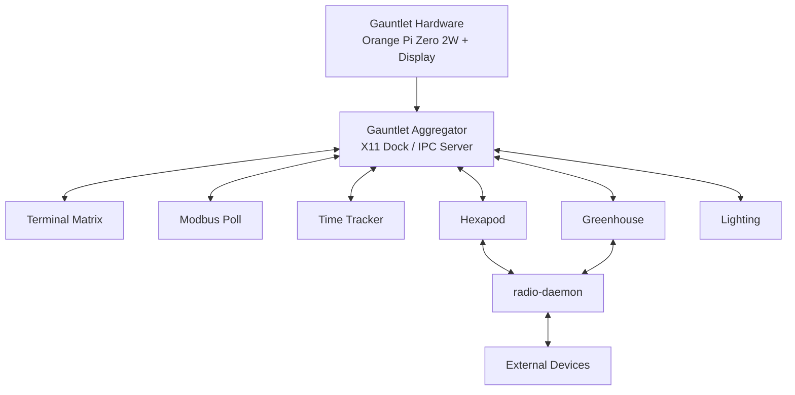

<table align="right">
  <tr>
    <td><a href="./README.md">🇬🇧 English</a></td>
    <td><b>🇷🇺 Русский</b></td>
  </tr>
</table>

# 🦾 Gauntlet — носимый Linux-терминал инженера

**Gauntlet** — носимый Linux-компьютер для разработки электроники, управления устройствами и выполнения базовых измерений непосредственно на предплечье.

Проект объединяет:

- ARM64 Linux-компьютер;
- QHD-дисплей 5.5";
- модульную среду на Qt 6;
- физические интерфейсы для подключения электроники;
- планируемые тестеры R/C и сервоприводов;
- моторизованную каретку в стилистике Bakugan New Vestroia.

По концепции это скорее **wearable embedded lab**, чем умные часы или телефонный интерфейс.

---

## 🎯 Назначение

Gauntlet должен давать быстрый доступ к инженерным инструментам без необходимости каждый раз раскладывать ноутбук или отдельный настольный прибор.

Основные сценарии:

- несколько инженерных терминалов;
- чтение и запись Modbus-регистров;
- управление Hexapod;
- мониторинг Greenhouse;
- управление освещением;
- подключение к внешним платам через физические интерфейсы;
- простые измерения компонентов непосредственно устройством.

Программная архитектура намеренно сделана расширяемой: новые инструменты должны добавляться программно без переделки основной аппаратной платформы.

---

## ⚙️ Текущая аппаратная спецификация

| Узел | Текущая конфигурация |
|---|---|
| Форм-фактор | Linux-терминал на предплечье |
| Наружные габариты | **211 × 88 × 40 мм** |
| Вычислитель | **Orange Pi Zero 2W, 4 GB** |
| ОС / UI | Linux + Qt 6 |
| Экран | **Sharp LS055R1SX04**, 5.5", QHD 1440 × 2560 |
| Видео | Mini HDMI → HDMI-FPC → контроллер экрана |
| Аккумулятор | **4 × EVE INR18650-25P**, 2S2P |
| Энергия | ~7.2 В / 5 А·ч / **36 Вт·ч** |
| Корпус | PETG, 3D-печать |
| Цветовая схема | белый / фиолетовый |
| CAD | FreeCAD |

В текущем репозитории находятся software stack и исходная FreeCAD-модель. Механическая и электрическая сборка продолжают проектироваться.

---

## 🏗 Архитектура



Каждый инструмент работает отдельным процессом.

Aggregator не содержит остальные приложения внутри себя: они регистрируются через local IPC и получают команды `show` / `hide`.

---

# 🖥 Программная среда

## Gauntlet Aggregator

`GauntletAggregator` — центральная оболочка интерфейса.

Он создаёт нижнюю X11-панель высотой:

```text
64 px
```

с кнопками:

- Greenhouse;
- LED;
- Hexapod;
- Modbus Poll;
- Terminal Matrix;
- Time Tracker.

Через X11/EWMH панель регистрируется как настоящий desktop dock:

```text
_NET_WM_WINDOW_TYPE_DOCK
_NET_WM_STRUT
_NET_WM_STRUT_PARTIAL
```

Панель можно почти полностью скрыть, оставив только кнопку разворачивания.

---

## Local IPC

Aggregator создаёт сокет:

```text
aggregator
```

Приложения подключаются к нему через `QLocalSocket` и регистрируются JSON-сообщением:

```json
{
  "type": "register",
  "app": "terminal_matrix"
}
```

Для переключения интерфейсов используются команды:

```json
{
  "type": "show",
  "app": "terminal_matrix"
}
```

и:

```json
{
  "type": "hide",
  "app": "*"
}
```

Так отдельные программы остаются независимыми, но визуально работают как единая среда.

---

# 🖥 Terminal Matrix

Текущая реализация содержит **матрицу 4 × 3 из встроенных терминалов** на QTermWidget.

```text
┌────┬────┬────┬────┐
│ T1 │ T2 │ T3 │ T4 │
├────┼────┼────┼────┤
│ T5 │ T6 │ T7 │ T8 │
├────┼────┼────┼────┤
│ T9 │T10 │T11 │T12 │
└────┴────┴────┴────┘
```

Каждый терминал запускает `/bin/bash` и имеет собственные:

- рабочую директорию;
- название;
- цвет рамки.

Конфигурацию можно сохранить в JSON и восстановить позже.

Горячие клавиши:

- `Shift + Tab` — следующий терминал;
- `Ctrl + Shift + C` — copy;
- `Ctrl + Shift + V` — paste.

В дальнейшем предполагается использовать одну кодовую базу с разными размерами матрицы через конфигурацию, а не отдельные программы для ПК и Gauntlet.

---

## Terminal Hotkey

`TerminalHotkey` связывает системную горячую клавишу с Terminal Matrix.

Он отправляет Aggregator:

```json
{
  "type": "toggle_terminal"
}
```

Если Gauntlet-среда недоступна, запускается обычный:

```text
x-terminal-emulator
```

---

# 🔧 Modbus Poll

В Gauntlet входит собственный **Modbus RTU diagnostic tool** на Qt SerialBus.

Настраиваются:

- serial port;
- baud rate;
- parity;
- data bits;
- stop bits;
- slave ID;
- начальный адрес;
- количество регистров;
- polling period.

Поддерживаются типы:

```text
UInt16
Int16
UInt32 ABCD
Float32 ABCD
```

Реализованы:

- автоматический polling;
- пользовательские имена регистров;
- счётчики успешных и ошибочных запросов;
- запись Holding Registers;
- JSON-профили конфигурации.

---

# ⏱ Time Tracker

`TimeTracker` считает время активности окон.

На Linux используется X11:

```text
_NET_ACTIVE_WINDOW
_NET_WM_NAME
```

Статистика делится на:

- текущий пятиминутный период;
- суммарное время текущего запуска.

В исходниках также присутствует реализация определения активного окна для Windows.

---

# 🕷 Hexapod

Интегрированный интерфейс Hexapod поддерживает:

```text
W / A / S / D → движение
B             → base mode
```

Несколько WASD одновременно формируют битовую маску.

Для движения используется **latest-state queue**, а не обычная FIFO.

Если приходит новое состояние управления, старая ожидающая команда удаляется.

Это предотвращает воспроизведение устаревшей последовательности движения после задержки связи.

---

## Live 3D-модель

В интерфейс встроена модель Hexapod на Qt Quick 3D.

Контроллер передаёт:

```text
6 ног × 3 угла = 18 значений
```

для:

- coxa;
- femur;
- tibia.

Полученные значения обновляют суставы 3D-модели.

---

# 🌱 Greenhouse

В Gauntlet также встроен интерфейс управления Greenhouse.

Он отображает:

- температуру;
- влажность воздуха;
- влажность почвы;
- live-графики.

И позволяет управлять:

- насосом;
- вентилятором;
- автоматическим поливом;
- автоматической вентиляцией;
- порогом сухой почвы.

---

# 📡 Общий Radio Layer

Приложения не открывают физический serial/radio port напрямую.

```text
Qt Application
      ↓
QLocalSocket / JSON
      ↓
radio-daemon
      ↓
Serial / Radio
      ↓
Remote Device
```

Таким образом один физический канал связи может обслуживать несколько приложений.

---

# 🧱 Механическая система

В конструкции предусмотрена моторизованная прозрачная каретка над экраном.

Она включает:

- две боковые зубчатые рейки;
- два привода;
- модуль зубчатого зацепления 0.8;
- центральное прозрачное окно;
- постоянную activation card.

Каретка движется вдоль поверхности дисплея и освобождает рабочую область под ней.

Синхронизация приводов, концевые положения и контроль заедания ещё находятся в разработке.

---

## Activation Card

Используется одна постоянная прозрачная activation card.

Она работает как пространственный цветовой фильтр над QHD-дисплеем:

```text
динамическое изображение LCD
           +
цветовой фильтр карты
           =
видимый результат
```

Позже возможна программная пространственная компенсация пропускания RGB для разных участков карты.

---

# 🔋 Питание

Текущая конфигурация аккумулятора:

```text
4 × EVE INR18650-25P
        ↓
       2S2P
        ↓
~7.2 В / 5 А·ч / 36 Вт·ч
```

В конструкции предусмотрена 2S BMS.

BMS используется для защиты аккумулятора, но зарядка требует отдельного CC/CV-тракта до 8.4 В.

---

# 🔌 Инженерные интерфейсы

В передней части устройства планируются физические интерфейсы:

- CAN;
- RS-485 / Modbus;
- UART;
- SWD;
- опционально I²C / SPI;
- измерительные входы;
- питание.

Конкретная компоновка разъёмов пока не зафиксирована.

---

# 🧪 Измерительная часть MK1

Завершённый MK1 должен получить три базовых тестера.

## Сопротивление

Планируемая схема:

```text
переключаемый известный Rref
          +
неизвестный Rx
          ↓
12-bit ADC STM32
          ↓
автодиапазон
```

## Ёмкость

Ёмкость планируется измерять по времени заряда/разряда неизвестного конденсатора через известное сопротивление.

Необходим управляемый разряд и защита от подключения предварительно заряженного конденсатора.

## Сервоприводы

Планируются:

- GND / питание / signal;
- PWM от STM32;
- установка нейтрали;
- настройка диапазона;
- sweep из Qt;
- отдельное ограниченное по току питание серво.

Эти функции должны работать через отдельную STM32-плату.

---

# 🔬 Более поздние измерительные расширения

Не являются обязательными для первого завершённого MK1:

- DMM;
- осциллограф;
- электронная нагрузка;
- более сложные измерительные тракты.

Для них потребуется отдельная аналоговая часть, входная защита и калибровка.

---

# 🚧 Software Roadmap

Следующие пункты присутствуют в спецификации, но **ещё не реализованы**.

## Обновление одной кнопкой

Предполагаемый цикл:

```text
git pull
   ↓
ARM64 build
   ↓
установка в ~/.local/bin
   ↓
обновление systemd user services
   ↓
restart + диагностика
```

Ошибка сборки не должна заменять текущую рабочую версию.

## SQLite

Планируется единая локальная SQLite-база через Qt SQL / QSQLITE для:

- общих настроек приложений;
- телеметрии;
- инженерных логов;
- данных питания;
- будущей биометрии.

## Питание / КБЖУ

Планируется локальное меню:

- готовые блюда;
- ингредиенты;
- покупки;
- КБЖУ;
- несколько вариантов сетов питания.

Система должна помогать с выбором, а не автоматически назначать рацион.

## Биометрия

Возможные будущие функции:

- PPG-пульсометр;
- шагомер на IMU;
- история дневной активности.

Конкретное аппаратное решение пока не выбрано.

---

# 🔊 Аудио и голос

В спецификации также рассматривается локальный голосовой интерфейс.

Предполагаемый тракт:

```text
I²S microphone
      ↓
Orange Pi

Orange Pi
      ↓
I²S
      ↓
MAX98357A
      ↓
speaker
```

Аудиоаппаратура пока относится к проектируемой части устройства.

---

# 🛠 Deployment

Для нескольких приложений уже существуют scripts установки в **systemd user services**:

```text
build
 ↓
~/.local/bin
 ↓
register / restart user service
```

Это соответствует общей архитектуре независимых Gauntlet-сервисов.

---

# 📁 Структура репозитория

```text
Gauntlet/
├── app/
│   ├── desktop/
│   │   ├── GauntletAggregator/
│   │   ├── Greenhouse/
│   │   ├── Hexapod/
│   │   ├── ModbusPoll/
│   │   ├── TerminalHotkey/
│   │   ├── TerminalMatrix/
│   │   └── TimeTracker/
│   │
│   └── firmware/
│
├── 3d models/
│   └── Gauntlet.FCStd
│
├── README.md
└── README_RU.md
```

---

# ✅ Реализованный software stack

- [x] Модульная Qt 6 архитектура
- [x] X11 Aggregator / dock
- [x] Local IPC между приложениями
- [x] Сворачиваемая нижняя панель
- [x] Terminal Matrix 4 × 3
- [x] QTermWidget
- [x] JSON-профили терминалов
- [x] Terminal hotkey bridge
- [x] Modbus RTU Poll
- [x] Запись Holding Registers
- [x] UInt16 / Int16 / UInt32 / Float32
- [x] JSON-профили Modbus
- [x] Time Tracker
- [x] Управление Hexapod
- [x] Latest-state очередь движения
- [x] Qt Quick 3D Hexapod
- [x] Greenhouse UI
- [x] Клиентская архитектура radio-daemon
- [x] systemd user-service deployment
- [x] FreeCAD-модель

# 🚧 Разработка аппаратной платформы

- [ ] Финальное шасси
- [ ] Интеграция 5.5" дисплея
- [ ] Моторизованная каретка
- [ ] Аккумулятор 2S2P
- [ ] Передняя I/O-плата
- [ ] Тестер сопротивлений
- [ ] Тестер конденсаторов
- [ ] Тестер сервоприводов
- [ ] Аудио
- [ ] One-button updater
- [ ] Общая SQLite-база
- [ ] Дополнительные software modules
